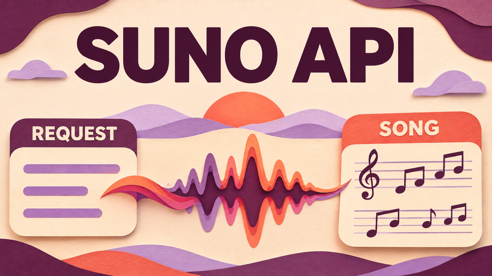
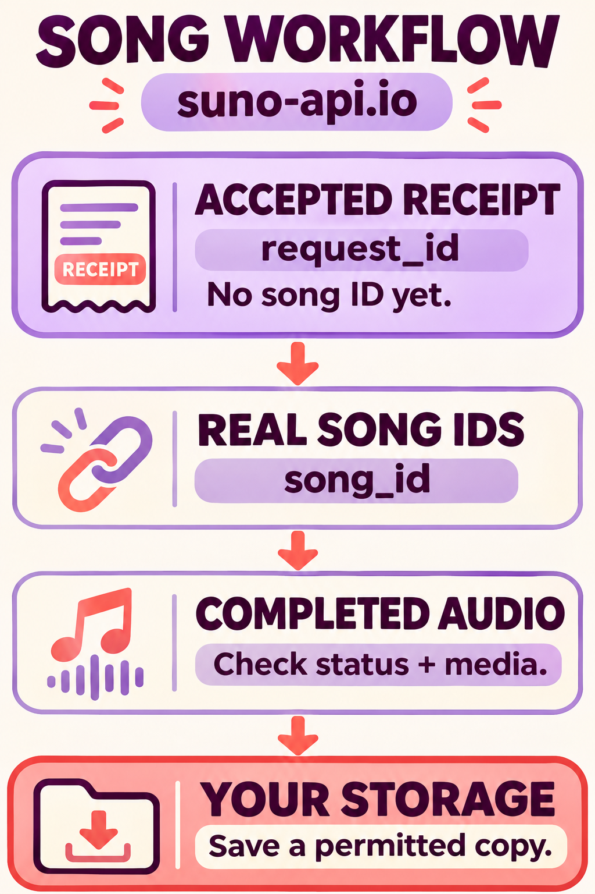

# Suno API: Choose Your Access Route and Build the Song Workflow

Adding a song-generation feature sounds straightforward: send a description, get music back, and let someone play it in your app. A search for “Suno API,” however, leads to several services with similar names and different accounts, keys and responses.

The first decision is which service you are connecting to. The next is how your app will follow an order until it becomes a finished audio file. Getting those two decisions right makes the code, cost estimate and release checks much easier to reason about.

Start with the access route, keep one provider’s contract together, then follow the song through completion and storage. Prices and usage permissions belong to that same choice of service.



*Choose the route, then follow the song to completion.*

## Choose the route before looking for a key

[Suno](https://platform.suno.com/) has a first-party developer platform that publicly describes a REST API for original songs, covers and mashups. On November 20, 2026, its public entry led to account sign-in. That confirms an official API entry exists; it does not establish who can obtain access, the available models or the API tariff. Those details were not available in the unauthenticated page.

[Suno MCP](https://suno.com/mcp) serves another need: making music from a connected AI assistant. MCP is the connection protocol between the assistant and Suno. Suno’s setup uses account sign-in and approval, needs no API key, and spends credits from the connected Suno plan. Generated songs appear in that account’s library. This is useful for an assistant workflow, but the setup page does not grant your app a REST integration contract.

Independent services issue their own credentials and publish their own endpoints. For example, [SunoAPI.com](https://sunoapi.com/) explicitly identifies itself as an independent third-party service. Its key and billing terms belong to that service.

| Route | What you connect | What to verify before implementation |
|---|---|---|
| First-party Suno API | Your app and an eligible Suno API account | Account access, endpoint documentation, models and API prices |
| Official Suno MCP | An assistant and your Suno account | Supported assistant, account permissions and plan credits |
| Independent API provider | Your app and that provider’s API account | Provider identity, exact contract, charges and usage authorization |

For an app backend, investigate the first or third route. For making songs inside an assistant, start with MCP. A consumer music subscription and a third-party API balance should not be assumed to cover the same work.

## Keep the provider, key and model together

Similar domain names do not mean matching APIs. Choose the API host, key, model identifier and response format from the same provider’s documentation.

The quickstart at [docs.sunoapi.org](https://docs.sunoapi.org/suno-api/quickstart) uses `api.sunoapi.org`, returns `data.taskId`, and checks for `SUCCESS` before reading the result array. Its model list and examples are not fully aligned: the list reaches `V5_5`, while an extension example names `V6`. That discrepancy needs confirmation before selecting a model; an example alone is not proof of current availability.

[SunoAPI.com](https://sunoapi.com/) instead documents `/api/v1/sonic/create`, `/api/v1/sonic/task/{id}` and an `mv` model field. The next section uses a third contract, from `www.suno-api.io`, with `suno-v6` and separate acceptance and song identifiers. A key from one service cannot be presumed to work at another host, and changing a model string does not translate the request.

Keep the provider key on your server rather than in browser JavaScript or a repository. Store the selected provider and model alongside each operation so that later status checks go back to the correct service. Otherwise, a valid job ID can look missing simply because your app queried the wrong provider.

[Moduck](https://moduck.ai/models?q=suno) is an AI API aggregation platform for developers and product teams. Its [developer overview](https://docs.moduck.ai/en/overview) explains model-scoped keys, an account-supplied API service origin and request or task identifiers. If you are considering a unified API layer for your app, use that documentation to check the connection requirements for the model you intend to use.

For Suno specifically, availability still needs confirmation. On November 20, 2026, Moduck’s public catalogue returned no matches for “suno” with All providers selected. That result does not establish permanent absence or account-specific availability. Before choosing Moduck for this feature, confirm a supported Suno model, its endpoint, price and usage permissions. The request examples in the next section belong to suno-api.io, not Moduck.

## Follow one request from receipt to stored audio

[suno-api.io’s generation documentation](https://www.suno-api.io/en/docs/current-music-create/) offers an acceptance-receipt mode: the service acknowledges an order while generation continues. The fragments below follow that provider’s documented contract, checked November 20. They have not been executed and are not a complete application.

The example requests an instrumental using `suno-v6` with default settings, including Max Mode off. Before submission, load the provider’s key into `SUNO_PROVIDER_KEY` on your server. Create and persist an `OPERATION_ID` for this one user action; keep it unchanged if you need to reconcile that same submission.

```bash
curl --max-time 300 'https://www.suno-api.io/api/music/create' \
  -H "Authorization: Bearer $SUNO_PROVIDER_KEY" \
  -H "Idempotency-Key: $OPERATION_ID" \
  -H 'Content-Type: application/json' \
  -d '{"model":"suno-v6","description":"A gentle acoustic instrumental for a quiet morning","instrumental":true,"accept_mode":"async"}'
```

An HTTP `202` response in this mode supplies `data.request_id`. It means the order was accepted and queued. It does not mean a song is ready, and this stage does not yet provide a real `song_id`. Neither the receipt number nor a task’s numeric `index` can substitute for one.

Save the receipt against your operation, then query acceptance progress with the same provider key. Replace the placeholder with that returned receipt number:

```bash
curl --max-time 60 \
  'https://www.suno-api.io/api/music/requests/REPLACE_RECEIPT_ID' \
  -H "Authorization: Bearer $SUNO_PROVIDER_KEY"
```

The progress response exposes real identifiers in `data.tasks[].song_id` as they become available. Track each returned song separately. A receipt status of `partial` can mean one of the two songs has completed; it does not mean every candidate is ready.

Once real song IDs exist, the [song-query documentation](https://www.suno-api.io/en/docs/current-music-query/) specifies a **comma-separated string** in `song_ids`, rather than an array. Replace these placeholders with the returned IDs:

```bash
curl --max-time 60 'https://www.suno-api.io/api/music/query' \
  -H "Authorization: Bearer $SUNO_PROVIDER_KEY" \
  -H 'Content-Type: application/json' \
  -d '{"model":"suno-v6","song_ids":"REPLACE_SONG_1,REPLACE_SONG_2"}'
```

While a song is pending or processing, an empty `audio_url` is normal. Wait for its completed status and a usable media address. Then, subject to the applicable download and usage permissions, copy the selected audio into your storage and keep your own file reference. Your player should not depend indefinitely on a provider’s temporary link.

Without acceptance-receipt mode, this provider describes the initial call as synchronous because it may wait for order acceptance. That terminology does not mean every response contains finished music. HTTP acceptance, song completion and a file saved for your app remain separate events.



*An accepted request still needs a finished song.*

## Treat a timeout as an unknown outcome

Suppose the connection drops after your app submits the description. Creating a fresh order may produce a second charge even though the first song is still generating. A timeout tells you the client stopped waiting; it does not tell you whether the provider accepted the order.

For this provider, the [acceptance-receipt contract](https://www.suno-api.io/en/docs/current-music-create/) documents an `Idempotency-Key` of at most 128 characters: replaying the same key returns the same receipt without accepting a second order. For a retry of the same operation, keep both the original key and request body unchanged. Reserve a new operation key for a genuinely new song request. Its documentation also says a failed generation is refunded. These are provider-specific published rules, not a guarantee for every service called Suno API.

If you have a receipt, continue checking it. If acceptance is uncertain, reconcile the operation against the provider’s [history endpoint](https://www.suno-api.io/en/docs/current-music-query/) and retained request information before deciding whether to submit another order. A quick glance at an empty list is not enough to prove a delayed order never existed.

Give your polling worker a deadline and backoff policy, and retain unresolved jobs for later reconciliation. The deadline is your application’s waiting budget, not proof of provider failure. Inspect response bodies as well as HTTP codes: this provider’s song-detail lookup can return HTTP `200` with `success:false` for a missing or inaccessible song.

There is also an inconsistency worth preserving: the create page’s Node example treats an audio URL as completion, while the query page tells readers to use status. Check completed status and valid media rather than inferring completion from a percentage or one field alone.

The query page says media addresses expire after seven days by default and files are recycled, while also saying another query can return a fresh address without regeneration. That is not a clear indefinite-retention promise. Save permitted files promptly and confirm any recovery requirement with the provider. Separately, [docs.sunoapi.org](https://docs.sunoapi.org/suno-api/quickstart) describes 15-day audio-file retention; that condition belongs to its own service.

## Price the songs you keep, not just the request

Public quotes checked November 20, 2026 illustrate why the billing unit matters:

[suno-api.io](https://www.suno-api.io/en/docs/current-music-create/) quotes CNY 0.6 per default generation call, usually returning two songs. Its documentation says the actual charge follows the current back-office configuration. Max Mode doubles the quoted call price to CNY 1.2; those settings should stay in the estimate.

[SunoAPI.com](https://sunoapi.com/) states 20 credits per song, reserved at submission and returned on confirmed failure. That is a credit-denominated per-song quote. A dollar cost needs that provider’s applicable credit-purchase conversion and operation conditions.

[sunoapi.org](https://sunoapi.org/ja) publicly offers a USD 5 package for 1,000 credits. A package price alone does not establish what a particular generation consumes, so a comparable dollar-per-song figure still needs the operation’s credit cost.

For an original hypothetical budget, assume 100 successful default-price calls to suno-api.io, exactly two completed candidates per call, no Max Mode and no extra paid operations:

- Generation cost: `100 × CNY 0.6 = CNY 60`.
- Completed candidates: `100 × 2 = 200`, or `CNY 60 ÷ 200 = CNY 0.30` each.
- If you keep 100 songs, cost per kept song is `CNY 60 ÷ 100 = CNY 0.60`.
- If you keep 60 songs, it becomes `CNY 60 ÷ 60 = CNY 1.00`.

The kept counts are assumptions, not measured quality or acceptance rates. Tax, currency conversion, hosting, extra generations, paid edits and any other charges are excluded. At the quoted Max Mode price, the same 100 calls would cost CNY 120; that does not prove the same number of candidates would meet your needs.

This is why a useful product budget records successful candidates and songs actually selected, as well as calls. Consumer Suno allowances, MCP plan credits and a third-party API wallet remain separate unless the applicable contract explicitly connects them.

## Resolve usage permission before shipping the song

Payment for a generation job does not by itself settle permission to distribute the result. [Suno’s terms](https://suno.com/terms-of-service), checked November 20, require appropriate rights and consents for submitted material. Free/basic outputs are restricted to personal, non-commercial use. Paid-tier assignment remains subject to the terms, and Suno does not warrant that copyright will exist in an output.

The commercial-use provisions also require a permitted download through an approved channel within the applicable tier’s allocation. A third-party invoice or a claim that audio is watermark-free does not establish that those requirements have been met.

Before using a provider for a commercial feature, obtain its applicable service and licensing terms: whose account generates the music, what authorizes access, which download channel is approved, and what your intended distribution permits. Check rights in uploaded lyrics, reference recordings and voices separately. The public pages reviewed here do not establish authorization for each independent provider.

## Verify one complete song before scaling the feature

After access, price and permission are confirmed, make the first evaluation about one complete user action. Record the chosen provider and model, your operation key, the acceptance receipt, each real song ID, the final status and the stored file. Check that a repeated submission of the same operation follows the provider’s documented duplicate-handling behavior rather than creating another purchase.

Then compare the charge and the selected result with your assumptions. Can the app recover after a connection failure? Can it still play its permitted saved copy after the original media URL expires? Does the intended release match the usage terms? These are proposed checks, not tests performed for this article.

Use that first evaluation to check whether the route, result handling and release conditions fit your feature before broader testing. A key and a successful submission are only the beginning.
